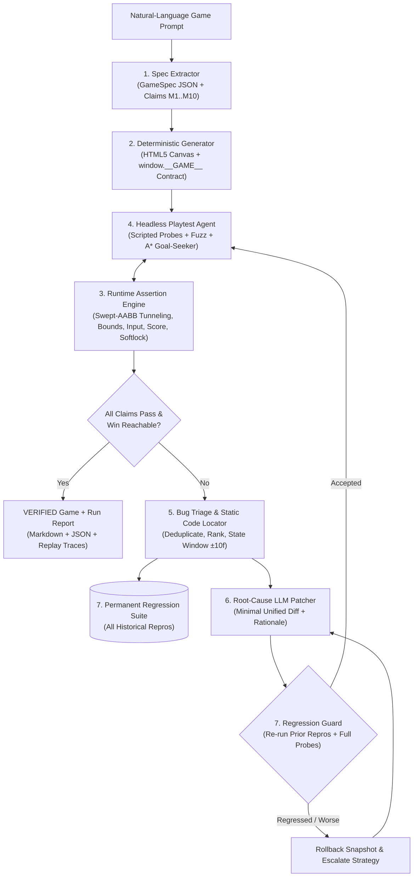

# PlaytestLoop — Closed-Loop LLM 2D Game Synthesis & Runtime Verification

**PlaytestLoop** is a closed-loop synthesis and verification framework where an LLM generates a deterministic 2D HTML5 Canvas game from a natural-language prompt, a headless playtesting agent executes and verifies mechanics at runtime, and an automated root-cause patcher iteratively repairs silent logical failures until every formal claim is verified.

---

## 1. Architecture Diagram



---

## 2. Quick Start & CLI Usage

### Run the Web Engineering Workbench (Port 3000)
```bash
npm run dev
```

### Run Unit Tests (`node:test`)
```bash
npx --yes tsx --test src/engine/engine.test.ts
```

### Run the CLI Orchestrator (`run.py`)
```bash
# Run closed-loop synthesis & verification on a custom game prompt
python3 run.py --prompt "A 2D platformer with high-speed dash, solid walls, coins, spikes, and an exit gate"

# Run closed-loop detection & repair on a specific seeded bug (B1_TUNNELING .. B5_SOFTLOCK)
python3 run.py --seeded-bug B1_TUNNELING

# Compute and print all 5 Evaluation Metrics across the 5 Seeded Bugs + Known-Good + 10 Game Prompts
python3 run.py --eval
```

---

## 3. Mandatory `window.__GAME__` Runtime Contract

Every generated and patched game exposes a deterministic, frame-steppable API without relying on wall-clock time (`Date.now()` / `requestAnimationFrame` delta jitter):

- `window.__GAME__.getState()`: Returns serializable JSON `{ frame, status: 'playing'|'won'|'lost', score, lives, level, worldWidth, worldHeight, entities: [{ id, type, x, y, w, h, vx, vy, alive, solid }] }`
- `window.__GAME__.step(n, inputs)`: Advances the simulation by `n` fixed-timestep ticks (`dt = 1/60s`) with programmatic input injection `{ left, right, up, down, jump, action }`
- `window.__GAME__.reset(seed)`: Resets the deterministic PRNG (`mulberry32(seed)`) and restores initial state
- `window.__GAME__.events`: Append-only event log (`collision`, `pickup`, `damage`, `spawn`, `death`, `win`, `lose`)

---

## 4. Seeded-Bug Verification Suite (5 Canonical Runtime Bugs)

| Seeded Bug ID | Silent Runtime Defect | Triggered Assertion & Claim | Closed-Loop Repair |
| :--- | :--- | :--- | :--- |
| `B1_TUNNELING` | High-speed dash (`vx=28`) steps across a `24px` solid wall in a single un-swept tick without firing a collision event | `A1: tunneling` (`M1`) via Swept-AABB Slab Detector | Replaces naive `x += vx` with sub-stepped swept collision (`stepsX = ceil(\|vx\|/4)`) |
| `B2_UNWIRED_INPUT` | Directional input read into unused local variable; `player.vx` stays `0` | `A3: input_responsiveness` (`M3`) | Wires `inputs.right`, `inputs.left`, and `inputs.jump` to velocity |
| `B3_SCORE_STUCK` | Overlapping pickup sets `alive = false` visually but omits `score += 10` and `pickup` event | `A5: pickup_score` (`M5`) | Increments `state.score` and pushes `pickup` event on overlap |
| `B4_UNREACHABLE_GOAL` | Goal spawned at `y = 28` near ceiling, far above highest platform (`y = 320`) and jump apex | `A8: win_lose_reachability` (`M8`) via A* Goal-Seeker | Moves goal to reachable platform altitude `y = 352` |
| `B5_SOFTLOCK` | Central corridor (`x ∈ [315, 395]`) zeroes velocity while keeping `status === 'playing'` | `A9: softlock_stall` (`M9`) via State-Hash Monitor | Removes corridor position trap while preserving solid wall physics |

---

## 5. Assumptions & Limitations

1. **Fixed-Timestep Determinism**: All physics updates operate at a fixed `60 Hz` tick (`dt = 1/60s`) seeded via `mulberry32(seed)` so any failure trace (`{ seed, inputs, frames }`) is 100% reproducible.
2. **2D AABB Geometry**: The swept collision detector models entities as axis-aligned bounding boxes (AABBs); rotated convex polygon SAT collision is outside the baseline scope.
3. **Bounded Horizon**: The headless goal-seeking planner evaluates trajectories up to `190` frames per episode; games requiring multi-minute puzzle backtracking require hierarchical macro-actions.
